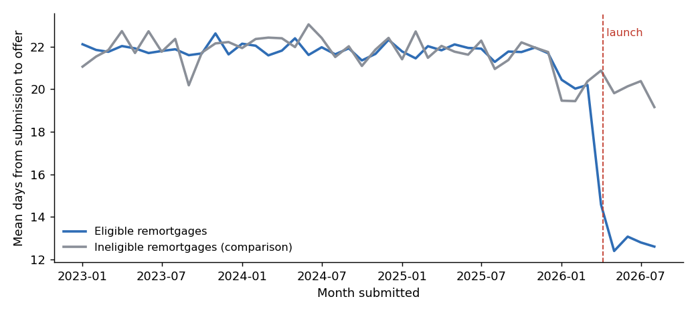
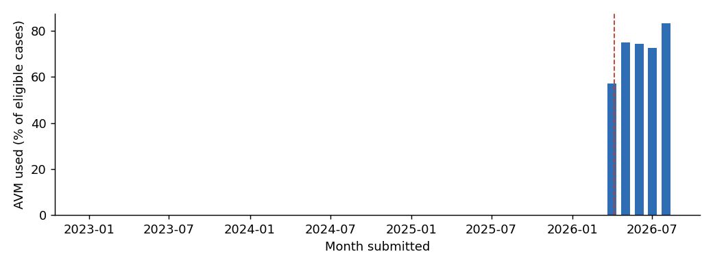

# Instant AVM remortgage: what changed after launch

*A post-launch evaluation written for a product manager. Generated by `analysis/feature_impact.py` from the
`fct_feature_impact` mart; every number here is computed, not typed.*

## The question

On 2026-04-06 the broker portal started offering an automated valuation (AVM) instead of a physical
valuation on eligible remortgages: standard properties and small HMOs, up to 75% LTV, for landlords with up to
15 mortgaged properties. A physical valuation takes one to two weeks to come back; an AVM comes back in a day
or two. Did offers get faster, and did fewer brokers walk away while waiting?

## The answer

**Eligible remortgages reach offer 7.4 days sooner because of the feature** (95% confidence interval
6.7 to 8.0 days), from a mean of 21.6 days before launch. About 73% of eligible cases
chose the AVM, so for the cases that used it the saving is larger, roughly 10 days.

**Withdrawals fell by 7.7 percentage points** among eligible cases (95% CI 0.9 to 14.5 points), from
21.4% before launch. The interval is wide: only 752 eligible applications were submitted after launch that are old enough to
have resolved, and a yes-or-no outcome carries far less information than a number of days. Treat the withdrawal result as
directional until there are more months of data.

## How it was measured, and two traps avoided

**Comparison group.** Ineligible remortgages (multi-unit blocks, over 75% LTV, large portfolios) could not use the
feature, so their change over the same months shows what would have happened anyway. Their days to offer moved by
-1.4 days (21.7 to 20.2) because underwriting got quicker for everyone in 2026. A simple before-and-after
on eligible cases alone would have claimed 8.8 days, crediting the feature with that general improvement. The
difference-in-differences estimate removes it.

**Censoring.** Cases submitted in the last 60 days of the data are excluded. Among the most recent submissions,
only the quick ones have an offer yet, so including them would make the post-launch period look faster than it is.

Standard errors are heteroskedasticity-robust (HC1) from an OLS regression of the outcome on eligibility, period
and their interaction, on 6,123 remortgage applications that reached offer (timing) and 6,818 applications (withdrawals).

## Check against the simulation's designed effect

This is simulated data, so the true effect is known (read only after estimating): the feature was built to save
10.4 days of valuation time on 70% of eligible cases, an expected -7.3 days on the eligible group, and to cut
withdrawals by 3.5 points. The days-to-offer estimate contains the designed effect in its 95% interval;
the withdrawal estimate does.

## What to watch next

- Take-up: 73% of eligible cases chose the AVM. Which broker networks are not using it, and why?
- Valuation quality: AVM market values against later physical valuations on the same properties, before extending
  eligibility to higher LTVs.
- Policy: 30 AVMs were run on cases outside the eligibility rules (see the data-quality register).
